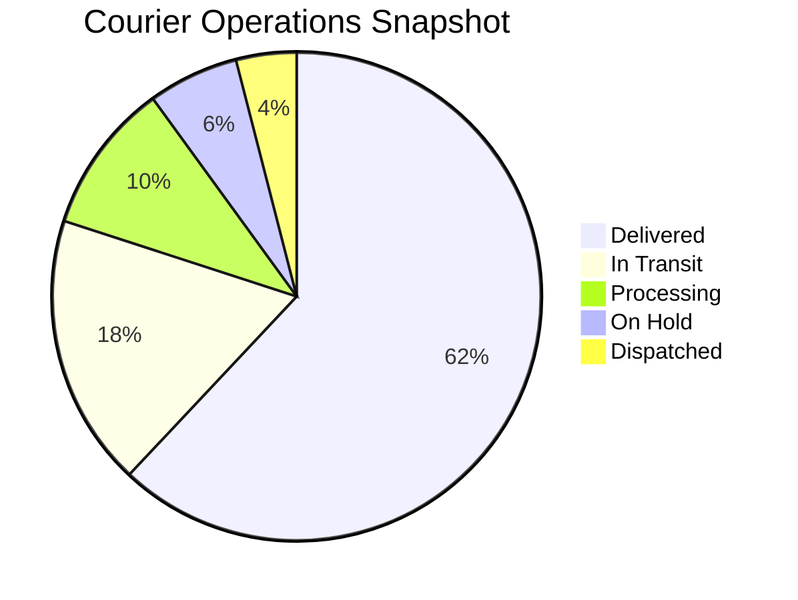
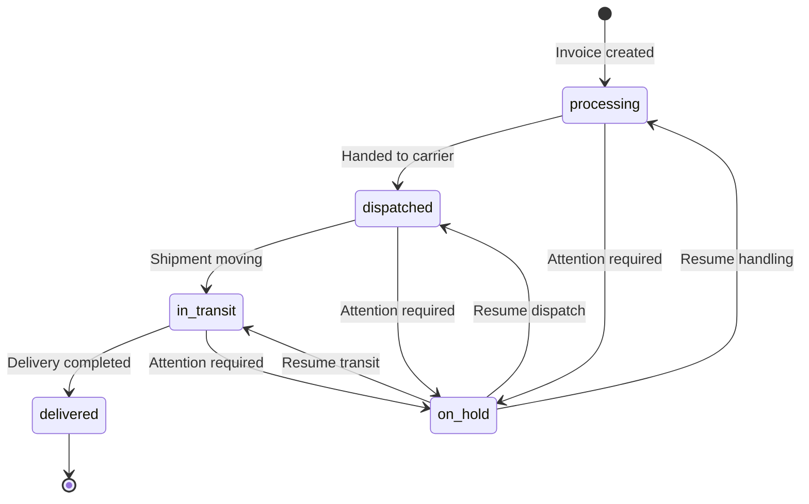

<div align="center">


# Express Courier Services
### Modern delivery operations for time-critical shipping and customer visibility

[](https://express-courier-services.vercel.app)
[](https://react.dev)
[](https://www.typescriptlang.org)
[](https://vite.dev)
[](https://supabase.com)

A polished courier-services website and management dashboard built with React, TypeScript, Vite, Tailwind CSS, and Supabase. The app combines customer-facing delivery tracking with a protected admin workflow for invoice management, status updates, brand customization, and content control.

[Live demo](https://express-courier-services.vercel.app) · [Features](#-features) · [Dashboard KPIs](#-dashboard-kpis) · [Quick start](#-quick-start) · [Admin portal](#-admin-portal)

</div>

---

## 📊 Project overview

<div align="center">

| KPI | Details |
|:---|:---|
| Application type | Courier brand marketing site + operational shipping dashboard |
| Frontend | React + TypeScript + Vite |
| Styling | Tailwind CSS |
| Platform services | Supabase Auth, Postgres, Storage |
| Deployment target | Vercel |
| Customer experience | Shipment lookup, service info, inquiry form |
| Staff workflow | Invoice CRUD, status tracking, settings, content management |

</div>

## 🖼️ Brand and product visuals

> Place the provided design assets in `docs/images/` to match the sections below.

### Brand mark

<p align="center">
  
</p>

### Operations and network

<p align="center">
  
</p>

### Homepage experience

<p align="center">
  
</p>

### Service stack and delivery capabilities

<p align="center">
  
</p>

---

## ✨ Features

### Public customer experience

- Responsive landing page with hero, CTA, stats, and trust-building content
- Search and tracking workflow for package lookup by tracking code
- Service cards with icons, descriptions, and optional image assets
- About section, company highlights, and configurable brand details
- Contact form that stores inbound messages in Supabase
- Dynamic public pages driven by slug-based CMS entries
- Fully configurable navigation and footer content
- Theme settings for colors, font family, and timezone

### Operational fulfillment flow

- Shipment lifecycle states: `processing`, `dispatched`, `in_transit`, `on_hold`, `delivered`
- Invoice creation, detail view, edit, delete, and filtering by status
- Real-time package timeline using invoice status-history records
- Embedded location map for current shipment position
- Recent invoice panel and operational KPI cards in the dashboard

### Admin controls

- Protected admin routes with Supabase authentication
- Dashboard overview with counts and recent invoice activity
- Invoice management workspace for courier operations
- Site settings editor for theme and business details
- Content management for pages, navbar, footer, and message inbox

### Business-ready capabilities

- Multi-region shipping concept with global footprint messaging
- Brand personalization to match courier-company identity
- External-facing tracking experience that is easy to share
- Structured data model for invoices, messages, and website settings

---

## 📈 Dashboard KPIs

The app includes a live dashboard that aggregates counts from Supabase data. Here is the operational KPI structure:

| Metric | Description |
|:---|:---|
| Total invoices | Overall count of invoice records |
| Processing | Current shipments in `processing` state |
| In transit | Current shipments in `in_transit` state |
| Delivered | Completed deliveries |
| Delivery rate | `delivered / total * 100` |
| Dispatched | Current shipments released to carriers |
| Unread messages | Messages with status `received` |



---

## 🔄 Shipment lifecycle



This lifecycle is surfaced in the public tracking page and the admin invoice detail flow.

---

## 🧱 Technology stack

| Layer | Stack |
|:---|:---|
| Frontend | React 18, TypeScript, React Router |
| Build tooling | Vite 5 |
| UI | Tailwind CSS 3 |
| Data & auth | Supabase Postgres, Auth, Storage |
| Icons | Lucide React |
| Document tooling | jsPDF, QR code generation |
| Linting & typing | ESLint, TypeScript |

---

## ⚡ Quick start

### Prerequisites

- Node.js LTS
- npm
- Supabase project with migrations applied

### 1) Install dependencies

```bash
git clone https://github.com/cupidnavaz/express-courier-delivery.git
cd express-courier-delivery
npm install
```

### 2) Configure environment variables

Create a `.env` file in the project root:

```dotenv
VITE_SUPABASE_URL=https://YOUR_PROJECT_ID.supabase.co
VITE_SUPABASE_ANON_KEY=YOUR_SUPABASE_ANON_KEY
```

### 3) Apply the database schema

```bash
supabase login
supabase link --project-ref YOUR_PROJECT_ID
supabase db push
```

### 4) Run locally

```bash
npm run dev
```

The app runs on the Vite local dev port, typically `http://localhost:5173`.

---

## ⚙️ Configuration

The client bootstrap lives in `src/lib/supabase.ts` and enforces required environment variables before the app initializes.

| Variable | Required | Purpose |
|:---|:---:|:---|
| `VITE_SUPABASE_URL` | Yes | Supabase project URL |
| `VITE_SUPABASE_ANON_KEY` | Yes | Public/anonymous key for browser access |

Additional runtime site details are read from Supabase tables like `site_settings`, `nav_links`, `footer_links`, and `pages` to power the public marketing site.

---

## 🗄️ Database and storage

Schema and configuration are defined in the `supabase/` folder, including migrations for:

- invoice and shipment data
- status-change history
- site settings and theme data
- navigation and footer content
- contact messages
- storage bucket configuration

### Key migration folders

```text
supabase/
├── config.toml
├── functions/
├── migrations/
└── ...
```

> Note: Keep secrets out of the repository. Use Supabase secrets or deployment platform env vars for any function credentials.

---

## 🔐 Admin portal

The app includes a protected admin experience with routes such as:

- `/admin/login`
- `/admin`
- `/admin/invoices`
- `/admin/invoices/new`
- `/admin/messages`
- `/admin/settings`
- `/admin/pages`
- `/admin/navbar`
- `/admin/footer`

This area is protected by Supabase Auth session checks and should be treated as an authenticated operations layer.

---

## 🗂️ Project structure

```text
.
├── src/
│   ├── components/
│   │   ├── admin/
│   │   └── public/
│   ├── context/
│   │   ├── AuthContext.tsx
│   │   └── SiteContext.tsx
│   ├── lib/
│   │   └── supabase.ts
│   ├── pages/
│   │   ├── admin/
│   │   └── public/
│   ├── App.tsx
│   ├── main.tsx
│   └── index.css
├── supabase/
│   ├── config.toml
│   ├── functions/
│   └── migrations/
├── docs/
│   └── images/
├── package.json
├── vite.config.ts
├── tailwind.config.js
├── tsconfig.json
├── index.html
└── README.md
```

---

## 📋 Available scripts

| Command | Purpose |
|:---|:---|
| `npm run dev` | Start Vite dev server |
| `npm run build` | Production build |
| `npm run preview` | Preview production build |
| `npm run lint` | Run ESLint |
| `npm run typecheck` | TypeScript validation |

Recommended verification before shipping:

```bash
npm run lint
npm run typecheck
npm run build
```

---

## 🚀 Deployment

This project is prepared for Vercel deployment and is currently associated with:

- [Express Courier Services live site](https://express-courier-services.vercel.app)

Recommended deployment steps:

1. Import the repository to Vercel.
2. Add `VITE_SUPABASE_URL` and `VITE_SUPABASE_ANON_KEY` under environment variables.
3. Verify Supabase migrations are applied to the correct project.
4. Deploy and confirm home, tracking, contact, and admin flows work correctly.

---

## 🛡️ Security notes

- Do not expose service-role keys in frontend env vars.
- Use Supabase Row Level Security for sensitive tables.
- Use admin accounts only for trusted staff access.
- Validate dynamic content before publishing any HTML-based page content.
- Protect all operational CRUD routes with proper authorization checks.

---

## 📁 README image asset checklist

Use these exact local paths in the repository when adding the provided design images:

| Design image | Target file |
|:---|:---|
| Main brand mark | `docs/images/brand-mark.png` |
| Facility and route network | `docs/images/courier-network.png` |
| Homepage hero image | `docs/images/homepage-hero.png` |
| Service cards / delivery visuals | `docs/images/core-services.png` |

---

## 🤝 Contributing

1. Fork the repo.
2. Create a feature branch.
3. Make your changes and verify with lint/typecheck/build.
4. Open a pull request with a clear summary and deployment notes.

---

<div align="center">

Built for fast delivery teams, transparent tracking, and customer confidence.

[Back to top](#express-courier-services)

</div>
