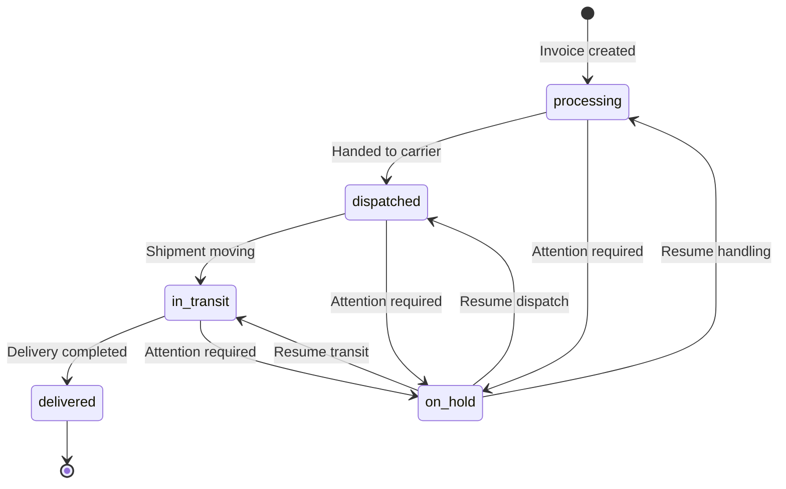

<div align="center">

# Express Courier Services
### Modern delivery operations for time-critical shipping and customer visibility

[](https://express-courier-services.vercel.app)
[](https://react.dev)
[](https://www.typescriptlang.org)
[](https://vite.dev)
[](https://supabase.com)

A courier-services website and management dashboard built with React, TypeScript, Vite, Tailwind CSS, and Supabase. Customers can look up shipments and submit inquiries; authorized staff can manage invoices, shipment statuses, and site content.

[Live demo](https://express-courier-services.vercel.app) · [Features](#-features) · [Dashboard KPIs](#-dashboard-kpis) · [Quick start](#-quick-start) · [Admin portal](#-admin-portal)

</div>

---

## 📊 Project overview

| Category | Details |
|:---|:---|
| Application | Courier marketing site and shipping dashboard |
| Frontend | React, TypeScript, Vite |
| Styling | Tailwind CSS |
| Platform services | Supabase Auth, Postgres, Storage |
| Deployment | Vercel |
| Customer experience | Shipment lookup, service information, inquiry form |
| Staff workflow | Invoice management, status tracking, settings, content management |

## ✨ Features

### Public customer experience

- Responsive landing page with configurable hero, statistics, and calls to action
- Shipment lookup by tracking code
- Service cards, company information, and configurable brand details
- Contact form that stores inbound messages in Supabase
- Dynamic public pages, navigation, and footer content
- Theme settings for colors, font family, and timezone

### Operational fulfillment flow

- Shipment statuses: `processing`, `dispatched`, `in_transit`, `on_hold`, and `delivered`
- Invoice creation, viewing, editing, deletion, and status filtering
- Chronological package timeline based on invoice status-history records
- Embedded map when a shipment location is available
- Dashboard KPI cards and a recent-invoices panel

### Admin controls

- Admin routes protected by Supabase authentication
- Invoice management, site settings, dynamic pages, navigation, footer, and message inbox

---

## 📈 Dashboard KPIs

The dashboard requests invoice and message counts from Supabase when it loads. It displays the following metrics; these are count cards, not historical trend charts:

| Metric | Description |
|:---|:---|
| Total invoices | Count of invoice records |
| Processing | Invoices currently in `processing` status |
| In transit | Invoices currently in `in_transit` status |
| Delivered | Invoices currently in `delivered` status |
| Delivery rate | `delivered / total invoices * 100` (0% when there are no invoices) |
| Dispatched | Invoices currently in `dispatched` status |
| Received messages | Messages whose status is `received`; this is not a separate unread/read count |

The delivery rate is calculated from current invoice statuses, not from historical shipment events. The dashboard does not display a live status-distribution chart.

## 🔄 Shipment lifecycle



This diagram describes the statuses and transitions represented in the application; it is not a guarantee that every shipment follows one fixed route.

## 🧱 Technology stack

| Layer | Stack |
|:---|:---|
| Frontend | React 18, TypeScript, React Router |
| Build tooling | Vite 5 |
| UI | Tailwind CSS 3 |
| Data and authentication | Supabase Postgres, Auth, Storage |
| Icons | Lucide React |
| Document tooling | jsPDF, QR code generation |
| Linting and typing | ESLint, TypeScript |

---

## ⚡ Quick start

### Prerequisites

- Node.js LTS and npm
- A Supabase project
- Supabase CLI to apply database migrations

### 1. Install dependencies

```bash
git clone https://github.com/cupidnavaz/express-courier-delivery.git
cd express-courier-delivery
npm install
```

### 2. Configure environment variables

Create a `.env` file in the project root:

```dotenv
VITE_SUPABASE_URL=https://YOUR_PROJECT_ID.supabase.co
VITE_SUPABASE_ANON_KEY=YOUR_SUPABASE_ANON_KEY
```

Use the browser-safe anon/public key only. Never put a service-role key in a `VITE_` variable.

### 3. Apply the database schema

With the Supabase CLI installed and authenticated:

```bash
supabase login
supabase link --project-ref YOUR_PROJECT_ID
supabase db push
```

### 4. Run locally

```bash
npm run dev
```

Vite prints the local URL in the terminal (typically `http://localhost:5173`).

---

## ⚙️ Configuration

The Supabase client is initialized in `src/lib/supabase.ts` and requires both environment variables below.

| Variable | Required | Purpose |
|:---|:---:|:---|
| `VITE_SUPABASE_URL` | Yes | Supabase project URL |
| `VITE_SUPABASE_ANON_KEY` | Yes | Public/anonymous key for browser access |

Site settings and content are loaded from Supabase tables, including `site_settings`, `nav_links`, `footer_links`, and `pages`.

## 🗄️ Database and storage

Database migrations are in `supabase/migrations/`. They define the invoice and shipment workflow, status history, site settings and content, navigation and footer links, inbound messages, and media storage configuration. Supabase project configuration is in `supabase/config.toml`.

Keep secrets out of the repository. Configure any function credentials using Supabase secrets or deployment-platform environment variables.

## 🔐 Admin portal

Admin routes include:

- `/admin/login`
- `/admin`
- `/admin/invoices` and `/admin/invoices/new`
- `/admin/messages`
- `/admin/settings`
- `/admin/pages`
- `/admin/navbar`
- `/admin/footer`

Admin access requires a Supabase Auth session. Configure authorized staff accounts through your Supabase project's access process, and enforce least-privilege access with database policies. Hiding or protecting UI routes alone is not a substitute for database authorization.

## 🗂️ Project structure

```text
.
├── src/
│   ├── components/
│   │   ├── admin/
│   │   └── public/
│   ├── context/
│   ├── lib/
│   ├── pages/
│   │   ├── admin/
│   │   └── public/
│   ├── App.tsx
│   └── main.tsx
├── supabase/
│   ├── config.toml
│   ├── functions/
│   └── migrations/
├── package.json
├── vite.config.ts
├── tailwind.config.js
├── tsconfig.json
└── README.md
```

## 📋 Available scripts

| Command | Purpose |
|:---|:---|
| `npm run dev` | Start the Vite development server |
| `npm run build` | Create the production build |
| `npm run preview` | Preview the production build locally |
| `npm run lint` | Run ESLint |
| `npm run typecheck` | Run the TypeScript check |

Before submitting a change, run:

```bash
npm run lint
npm run typecheck
npm run build
```

## 🚀 Deployment

The project is deployed at [express-courier-services.vercel.app](https://express-courier-services.vercel.app). For a Vercel deployment:

1. Import the repository into Vercel.
2. Add `VITE_SUPABASE_URL` and `VITE_SUPABASE_ANON_KEY` as environment variables.
3. Apply the Supabase migrations to the intended project.
4. Deploy and verify the homepage, tracking lookup, contact form, and authorized admin access.

## 🛡️ Security notes

- Vite client variables are bundled into the browser; expose only public/anon credentials.
- Keep service-role keys and other secrets in server-side or Supabase secret configuration.
- Review row-level security for invoices, status history, messages, and site administration data.
- Enforce administrator authorization in database policies, not only in the UI.
- Validate and sanitize dynamic page content before publishing HTML.

## 🖼️ Optional README image assets

The repository does not currently include these image files. If you add the corresponding assets, use these paths and add matching image references to the README:

| Asset | Path |
|:---|:---|
| Brand mark | `docs/images/brand-mark.png` |
| Courier network | `docs/images/courier-network.png` |
| Homepage hero | `docs/images/homepage-hero.png` |
| Core services | `docs/images/core-services.png` |

## 🤝 Contributing

1. Fork the repository and create a focused feature branch.
2. Install dependencies with `npm install`.
3. Make and test your change; run lint, typecheck, and build.
4. Open a pull request describing the change and any migration or environment-variable updates.

---

<div align="center">

Built for clearer delivery operations and a better shipping experience.

[Back to top](#express-courier-services)

</div>
