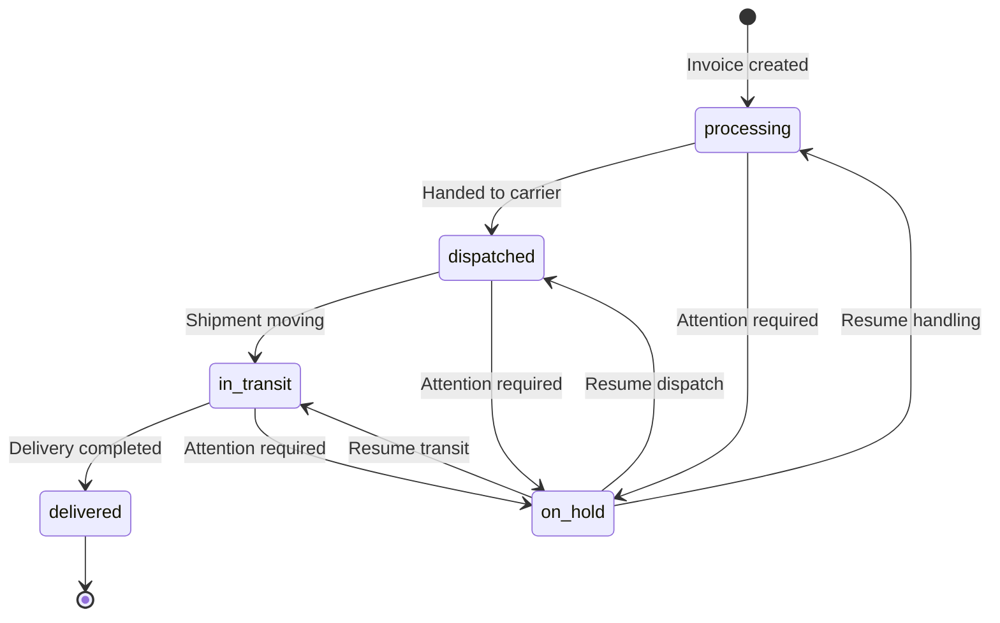

<div align="center">

<!-- Place attached image 1 at docs/images/brand-mark.png -->


# Express Courier Services
### A modern courier experience, from booking to delivery visibility

[](https://express-courier-services.vercel.app)
[](https://react.dev/)
[](https://www.typescriptlang.org/)
[](https://vite.dev/)
[](https://supabase.com/)

**A responsive courier-services website and operations portal** built with React, TypeScript, Vite, Tailwind CSS, and Supabase. Customers can explore services, submit inquiries, and look up shipment progress; authenticated staff can manage invoices, shipment statuses, and site content.

[Explore the app](https://express-courier-services.vercel.app) · [Features](#-features) · [Quick start](#-quick-start) · [Configuration](#-configuration) · [Admin portal](#-admin-portal)

</div>

---

## Contents

<details>
<summary>Open the README guide</summary>

- [Project snapshot](#-project-snapshot)
- [Product preview](#-product-preview)
- [Features](#-features)
- [Shipment lifecycle](#-shipment-lifecycle)
- [Technology](#-technology)
- [Quick start](#-quick-start)
- [Configuration](#-configuration)
- [Database and storage](#-database-and-storage)
- [Admin portal](#-admin-portal)
- [Project structure](#-project-structure)
- [Available scripts](#-available-scripts)
- [Deployment](#-deployment)
- [Security notes](#-security-notes)
- [Contributing](#-contributing)

</details>

## 🚀 Project snapshot

| | | |
|:--|:--|:--|
| **Experience** | Public marketing site, tracking page, and protected admin portal | **Frontend** |
| **Application** | Single-page application with lazy-loaded routes | **Data & auth** |
| **Backend** | Supabase Postgres, Auth, and Storage | **Hosting** |
| **Production preview** | [express-courier-services.vercel.app](https://express-courier-services.vercel.app) | **Repository** |

> **About the numbers:** The homepage includes editable stat fields and fallback display values (for example, package and service metrics). Those fallback values are presentation defaults—not live operational analytics. The admin overview’s invoice, delivery-status, and received-message counts are queried from Supabase.

## 🖼️ Product preview

The visual assets below correspond to the four images supplied with the project brief. Add the image files at the listed paths to make them render on GitHub (see [Image assets](#-image-assets)).

### Brand identity

<!-- Attached image 1: logo / brand mark -->
<p align="center"></p>

### The courier operation

<!-- Attached image 2: facility, team, and global network -->
<p align="center"></p>

### Customer-facing experience

<!-- Attached image 3: homepage hero and shipment tracking experience -->
<p align="center"></p>

### Core service offering

<!-- Attached image 4: service cards and delivery capabilities -->
<p align="center"></p>

## ✨ Features

### Customer-facing website

- **Responsive landing page** with a configurable hero, call to action, and shipment lookup.
- **Homepage tracking form** that opens the tracking page with the tracking code prefilled.
- **Service cards** with configurable icons, descriptions, and optional imagery.
- **Editable company story and highlights**, including an image, badge, and feature list.
- **Configurable statistics and selling points** for the marketing homepage.
- **Contact form** that writes inbound customer messages to Supabase.
- **Dynamic content pages** served by slug, with published/unpublished page handling.
- **Site-wide navigation and footer links** loaded from settings.
- **Brand customization** for primary, secondary, and accent colors; supported Google Fonts; and timezone.

### Shipment tracking

- Search by tracking code, including tracking links with a `?code=` query parameter.
- Shipment summary with current status, sender, receiver, package description, shipping method, and estimated delivery date.
- Chronological status history with timestamps, notes, and optional location details.
- Embedded map for a recorded current location.
- Clear loading, not-found, and query-error states.

### Staff operations

- Supabase-authenticated admin sign-in and protected admin routes.
- Operations overview with invoice counts, processing/in-transit/delivered status cards, delivery-rate KPI, dispatched count, received-message count, and recent invoices.
- Invoice creation, viewing, editing, deletion, search, and status filtering.
- Tracking identifiers and delivery statuses shared with the public tracking experience.
- Admin tools for site settings, dynamic pages, navigation, footer links, and customer messages.
- PDF and QR-code dependencies are present in the application for invoice/document workflows.

### Operational dashboard cards

The admin overview provides live count cards for total invoices, processing, in transit, and delivered, plus secondary cards for delivery rate, dispatched shipments, and received messages. Recent invoice rows link to their detail pages.

| KPI card | Meaning |
|:--|:--|
| **Total invoices** | All invoice records returned by the database count query |
| **Processing** | Invoices currently in `processing` status |
| **In transit** | Invoices currently in `in_transit` status |
| **Delivered** | Invoices currently in `delivered` status |
| **Delivery rate** | `delivered ÷ total invoices × 100` (0% when there are no invoices) |
| **Dispatched** | Invoices currently in `dispatched` status |
| **Received messages** | Messages whose status is `received` |

> The current dashboard is KPI-card and recent-record oriented; it does not currently implement historical trend charts. The lifecycle diagram below visualizes the defined status flow, not a live chart or guarantee that every shipment follows one fixed route.

## 📦 Shipment lifecycle



Statuses are represented in code as `processing`, `dispatched`, `in_transit`, `on_hold`, and `delivered`. A shipment timeline is built from its invoice status-history records.

## 🧰 Technology

| Layer | Tools |
|:--|:--|
| UI | React 18, TypeScript, React Router |
| Build | Vite 5 |
| Styling | Tailwind CSS 3, PostCSS, Autoprefixer |
| Backend services | Supabase JavaScript client, Postgres, Supabase Auth, Supabase Storage |
| Icons | Lucide React |
| Documents / codes | jsPDF and `qrcode` |
| Code quality | ESLint, TypeScript |

## ⚡ Quick start

### Prerequisites

- Node.js (LTS recommended) and npm
- A Supabase project with the migrations in this repository applied

### 1. Clone and install

```bash
git clone https://github.com/cupidnavaz/express-courier-delivery.git
cd express-courier-delivery
npm install
```

### 2. Configure Supabase

Create a `.env` file in the project root (or configure the same values in your deployment provider):

```dotenv
VITE_SUPABASE_URL=https://YOUR_PROJECT_ID.supabase.co
VITE_SUPABASE_ANON_KEY=YOUR_SUPABASE_ANON_KEY
```

Use the project URL and **anon/public** key from Supabase project settings. Do not put a service-role key in a `VITE_` variable or expose it in browser code.

### 3. Apply database migrations

With the Supabase CLI installed and authenticated, link the local project and apply the checked-in migrations:

```bash
supabase login
supabase link --project-ref YOUR_PROJECT_ID
supabase db push
```

Review your Supabase project's security and row-level-security policies before using real customer or shipment data.

### 4. Start the development server

```bash
npm run dev
```

Vite prints the local URL in the terminal (typically `http://localhost:5173`).

## ⚙️ Configuration

The client initializes Supabase in `src/lib/supabase.ts` and requires both `VITE_SUPABASE_URL` and `VITE_SUPABASE_ANON_KEY`. The app intentionally throws a configuration error if either value is missing.

| Variable | Required | Purpose |
|:--|:--:|:--|
| `VITE_SUPABASE_URL` | Yes | Supabase project endpoint |
| `VITE_SUPABASE_ANON_KEY` | Yes | Browser-safe Supabase anon/public key |

Public site settings, navigation, and footer links are read by the site context. The admin settings UI can control configured content and theme settings. Set the timezone to control the display of dates in tracking and admin views.

## 🗄️ Database and storage

Database migrations are under [`supabase/migrations`](supabase/migrations). The schema supports the app’s shipment/invoice workflow, status history, site settings and content, navigation/footer links, and inbound messages. Additional migrations configure media storage and extend site content.

The repository also includes a Supabase `send-email` Edge Function configuration. Configure any provider credentials and function secrets through Supabase's function secrets settings; never commit secrets to the repository. The website contact form itself inserts inbound messages into the `messages` table.

To inspect migration history:

```bash
ls supabase/migrations
```

## 🔐 Admin portal

- Login route: `/admin/login`
- Protected operations area: `/admin`
- Invoice management: `/admin/invoices`
- Site pages, settings, navigation, footer, and message management are available through the admin routes.

Admin routes require a valid Supabase Auth session. Create or invite administrator accounts through your Supabase project's approved access process; do not rely on the public-facing sign-up flow as an authorization policy. Review and enforce least-privilege database policies for admin-only data.

## 🗂️ Project structure

```text
.
├── src/
│   ├── components/
│   │   ├── admin/          # Admin shell and shared admin UI
│   │   └── public/         # Public navigation and footer
│   ├── context/            # Authentication and site configuration providers
│   ├── lib/                # Supabase client
│   ├── pages/
│   │   ├── admin/          # Dashboard, invoices, settings, content, messages
│   │   └── public/         # Homepage, tracking, dynamic pages
│   ├── types/              # Shared TypeScript domain types
│   ├── App.tsx             # Route tree and protected-route boundary
│   └── main.tsx            # Application entry point
├── supabase/
│   ├── functions/          # Edge functions
│   └── migrations/         # Database schema and policy changes
├── docs/images/            # README visual assets (add supplied images here)
└── package.json
```

## 📜 Available scripts

| Command | Description |
|:--|:--|
| `npm run dev` | Start the Vite development server |
| `npm run build` | Create the production build in `dist/` |
| `npm run preview` | Preview the production build locally |
| `npm run lint` | Run ESLint |
| `npm run typecheck` | Run the application TypeScript check |

Before submitting a change, run:

```bash
npm run lint
npm run typecheck
npm run build
```

## 🚀 Deployment

The production site is hosted at [express-courier-services.vercel.app](https://express-courier-services.vercel.app). For a Vercel deployment:

1. Import the repository into Vercel.
2. Add `VITE_SUPABASE_URL` and `VITE_SUPABASE_ANON_KEY` to the project's environment variables for the required environments.
3. Ensure the Supabase schema and storage migrations are applied to the intended project.
4. Deploy; Vercel uses the Vite build output in `dist/`.
5. Verify the public homepage, tracking lookup, contact form, and authorized admin access.

## 🛡️ Security notes

- Vite client variables are bundled into the browser; only expose public/anon credentials there.
- Keep Supabase service-role keys, mail-provider credentials, and other secrets in server-side or Supabase secret configuration.
- Review row-level security for every exposed table, especially invoices, status history, messages, and site administration data.
- Protect administrator account creation and enforce authorization in database policies—not only by hiding UI routes.
- Dynamic page content is rendered as HTML; only trusted, sanitized content should be published.

## 🖼️ Image assets

The four supplied images are intended for these sections and relative asset paths:

| Image | README section | Save as |
|:--:|:--|:--|
| 1 | Brand identity / logo | `docs/images/brand-mark.png` |
| 2 | Courier operation / facility and team | `docs/images/courier-network.png` |
| 3 | Customer-facing homepage hero | `docs/images/homepage-hero.png` |
| 4 | Core service offering | `docs/images/core-services.png` |

Create `docs/images/` and add the supplied image files using these names. GitHub renders these local relative image references automatically once the files are committed. Use optimized PNG, JPEG, or WebP assets and meaningful alt text.

## 🤝 Contributing

1. Fork the repository and create a focused feature branch.
2. Install dependencies with `npm install`.
3. Make and test your change; run lint, typecheck, and build.
4. Open a pull request describing the user-facing change and any migration or environment-variable updates.

---

<div align="center">

Built for clearer delivery operations and a better shipping experience.

[Back to top](#express-courier-services)

</div>
